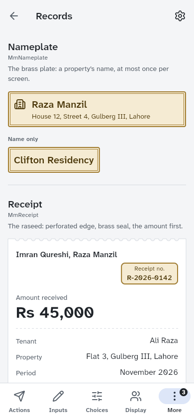
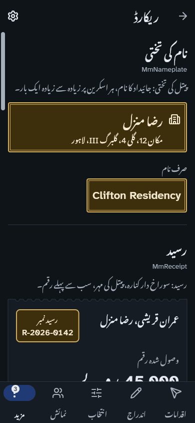
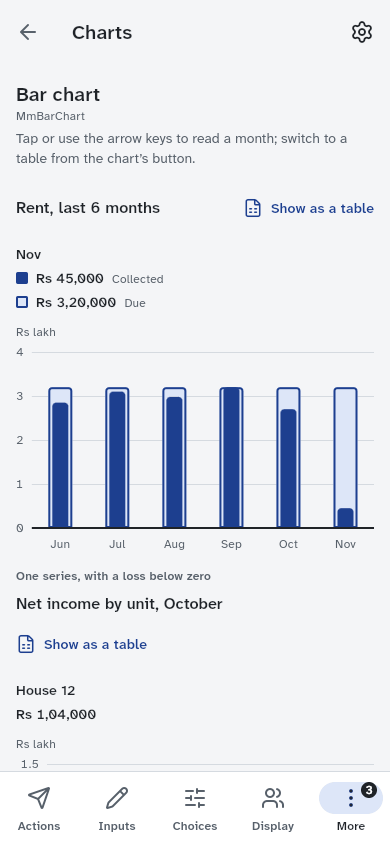

# Maalik-e-Makaan (مالکِ مکان)

[](https://github.com/ar27111994/maalik-e-makaan/actions/workflows/ci.yml)
[](https://github.com/ar27111994/maalik-e-makaan/actions/workflows/security.yml)
[](https://scorecard.dev/viewer/?uri=github.com/ar27111994/maalik-e-makaan)
[](https://www.bestpractices.dev/projects/16503)
[](LICENSE)

Tenant and property management for **Pakistani landlords**, in English and Urdu. It replaces
registers, spreadsheets and WhatsApp threads with one trustworthy ledger, and handles the work
that global tools ignore:

- cash-first rent collection with numbered, bilingual receipts;
- dues that generate themselves, late fees, deposits and an overdue list;
- caretakers and relatives who collect on behalf of an overseas owner, with cash handovers and every
  change recorded in the database's audit log (a screen to read it is still to come);
- police tenant registration, rent-agreement and utility tracking;
- July–June tax-year statements, including tax withheld by company tenants;
- reminders over WhatsApp, in English, Urdu or Roman Urdu.

## Status

**v1.2.0 is the latest release** <!-- x-release-please-version -->
([release notes](CHANGELOG.md), downloads on the
[releases page](https://github.com/ar27111994/maalik-e-makaan/releases)): Android APKs and app
bundle, the web app at <https://maalik-e-makaan.vercel.app> and an unsigned iOS build; the first,
v1.0.0, came out on 9 November 2026. The domain library, the database, the Edge Functions, the
design system, the app, the website and CI/CD are built, tested and deployed, and the browser UAT
passes ([`docs/uat.md`](docs/uat.md)).
Still to come before inviting real users: a native-speaker review of the Urdu and a legal review
of the privacy and terms pages. Google Play waits on a D-U-N-S number, and the App Store on an
Apple Developer Program membership. [`docs/release-readiness.md`](docs/release-readiness.md) has
what the owner must still do.
[`.planning/STATE.md`](.planning/STATE.md) has the current position and blockers, and
[`.planning/REQUIREMENTS.md`](.planning/REQUIREMENTS.md) says what remains of each requirement.

## Screenshots

From the design-system gallery's acceptance record
([`packages/mm_ui/example/screenshots/`](packages/mm_ui/example/screenshots): every
page in English light and Urdu dark, on a phone and a desktop window):

<p>
  
  
  
</p>

The record's Urdu screenshots were taken before Urdu interface text moved from Nastaliq to Noto
Sans Arabic (decision D-19); the Urdu goldens below show the current face.

The app's screens are recorded as golden images in six variants (light, dark, both high-contrast
themes, Urdu and 200% text) in [`app/test/src/goldens/goldens/`](app/test/src/goldens/goldens),
for example the [dashboard](app/test/src/goldens/goldens/dashboard_light.png),
[recording a payment](app/test/src/goldens/goldens/record_payment_light.png),
[a receipt in Urdu](app/test/src/goldens/goldens/receipt_urdu.png),
[a tenancy's ledger](app/test/src/goldens/goldens/ledger_dark.png) and the
[tax-year statement](app/test/src/goldens/goldens/tax_year_light.png).

## How it is built

| Part             | Where                 | What                                                                                                                                                       |
| ---------------- | --------------------- | ---------------------------------------------------------------------------------------------------------------------------------------------------------- |
| App              | `app/`                | Flutter 3.47 for Android, iOS and the web. Riverpod 3, go_router 18, English and Urdu (right to left).                                                     |
| Domain library   | `packages/mm_core/`   | Pure Dart: exact money in paisa, rent and late-fee maths, Pakistan time, a person's declared residence and own time zone, CNIC, phone and IBAN checks.     |
| Design system    | `packages/mm_ui/`     | Tokens, themes (light, dark, high contrast), icons and accessible components. See [`DESIGN.md`](DESIGN.md).                                                |
| Database         | `supabase/migrations` | Postgres 17 on Supabase: row-level security on every table, a ledger with idempotent payments and gapless receipts, scheduled jobs.                        |
| Edge Functions   | `supabase/functions`  | Deno 2: account deletion, invitations, health checks and storage clean-up.                                                                                 |
| Website          | `website/`            | Astro static site in English and Urdu: guides, calculators, no tracking. See [`website/README.md`](website/README.md).                                     |
| Formal models    | `formal/`             | TLA+ models of the concurrent paths; Lean 4, Bend and Z3 proofs of the money arithmetic. See [`formal/README.md`](formal/README.md).                       |
| Shared contracts | `contracts/`          | Test vectors that keep Dart, SQL and TypeScript in agreement (rent maths, identity, text cleaning, residence and time zones), and the plain-Urdu glossary. |

Key decisions are recorded in [`.planning/PROJECT.md`](.planning/PROJECT.md):

- authorisation lives in Postgres;
- money is exact (never floating point);
- financial rows are voided, never deleted;
- secret keys never reach a client.

Read more:

- [`docs/architecture/app.md`](docs/architecture/app.md): how the app reads, writes, caches and
  retries;
- [`docs/architecture/permissions.md`](docs/architecture/permissions.md): who can do what, how the
  database enforces it, and the lock order;
- [`docs/operations.md`](docs/operations.md): scheduled jobs, secrets, health checks, hosting and
  deployment;
- [`docs/README.md`](docs/README.md): every document, by topic.

## Getting started

You need Flutter 3.47 (Dart 3.13), Deno 2.9, Node 22 and Python 3.12 or later. For the database
suites you also need PostgreSQL 16 with pgTAP, or the Supabase CLI with Docker.

```sh
make bootstrap   # dependencies, the pinned Python tools in .venv, and the git hooks
make help        # every target, with a description
make test        # tooling, Dart packages, the gallery, app, database and Edge Functions
```

Per area:

| Area                      | Commands                                                                              |
| ------------------------- | ------------------------------------------------------------------------------------- |
| Domain library            | `make test-core`                                                                      |
| Design system and gallery | `make test-ui test-gallery`; `cd packages/mm_ui/example && flutter run -d chrome`     |
| App                       | `make test-app`; run it against a local stack as below                                |
| Database                  | `make test-db test-db-concurrency` (local PostgreSQL 16 with pgTAP; `tool/db/env.sh`) |
| Edge Functions            | `make test-functions`; `make test-functions-e2e` with `supabase start`                |
| Website                   | `cd website && npm ci && npm run dev`; `make test-web`                                |
| Browser UAT               | `make test-uat` (Supabase CLI, Docker, Flutter, Node; [`docs/uat.md`](docs/uat.md))   |
| Formal verification       | `make formal-install verify`                                                          |

To run the app against a local Supabase stack:

```sh
supabase start
cp app/config/local.example.json app/config/local.json   # paste the publishable key
cd app && flutter run --dart-define-from-file=config/local.json
```

Coding agents start at [`AGENTS.md`](AGENTS.md); [`llms.txt`](llms.txt) indexes the docs for AI
readers.

## Quality gates and CI

Every change runs through CI ([`ci.yml`](.github/workflows/ci.yml)), and every check is a `make`
target, so a green `make` means a green pull request:

- formatting and linting for every language in the repository (Dart, TypeScript, Python, shell,
  SQL migrations, workflows, Markdown), the Unicode guard against invisible and bidi-control
  characters, the plain-Urdu guard (`tool/check_urdu_words.py`, `contracts/urdu_glossary.json`)
  against the formal words ordinary readers stumble on, and the design lint that keeps UI code on
  its tokens;
- analysis and tests for each Dart package with coverage gates (100% for `mm_core`, <!-- docs:coverage-ui from Makefile test-ui; generated by make docs, do not edit -->95%<!-- /docs:coverage-ui --> for
  `mm_ui`, <!-- docs:coverage-app from Makefile test-app; generated by make docs, do not edit -->90%<!-- /docs:coverage-app --> for the app), golden tests in six variants, and the gallery in every theme;
- Edge Function tests at 100% line, branch and function coverage;
- the pgTAP suites (<!-- docs:pgtap-count from supabase/tests/database select plan; generated by make docs, do not edit -->23 suites, 1,974 tests<!-- /docs:pgtap-count -->) and the concurrency scenarios on PostgreSQL, and again
  on the real Supabase stack, plus a migration lint that rejects what the Supabase CLI cannot
  apply;
- browser UAT: <!-- docs:uat-journeys from app/uat/tests/journeys.spec.ts; generated by make docs, do not edit -->14<!-- /docs:uat-journeys --> landlord journeys, in English and Urdu, through the release web build against a
  local Supabase stack, each checked against the database (`make test-uat`,
  [`docs/uat.md`](docs/uat.md));
- the website's checks, unit tests, Playwright with axe, and Lighthouse budgets;
- release builds for the web, Android and iOS (unsigned);
- the facts the docs repeat, generated from their sources and checked (`make docs-check`).

Commit messages and pull-request titles follow Conventional Commits with the scopes in
[`commitlint.config.mjs`](commitlint.config.mjs); release-please writes the changelog and the
version from them ([`release.yml`](.github/workflows/release.yml)). [`deploy.yml`](.github/workflows/deploy.yml)
pushes migrations and Edge Functions to Supabase and the app and website to Vercel, and
[`backup.yml`](.github/workflows/backup.yml) takes the weekly encrypted backup.

## Formal verification

Six TLA+ models (invitations, membership, storage cleanup, ledger payments, late fees and the
rate limiter) check the concurrent database paths; Lean 4, Z3 and Bend prove the money arithmetic
that Dart and SQL share. The models found real races, each fixed by a migration and kept as a
failing mutant. `make verify` runs every track's fast set with exactly pinned, checksum-verified
tools, as CI does. See [`formal/README.md`](formal/README.md).

## Security

Authorisation is enforced by the database: row-level security on every table, column grants,
role-checked write functions on a reviewed allowlist, and CHECK constraints that hold stored
text, phone numbers, CNICs and IBANs to the form the app reads back.
Clients hold only the publishable key. Security checks ([`security.yml`](.github/workflows/security.yml))
run CodeQL, gitleaks over the whole history, OSV-Scanner, dependency review and zizmor, and every
action is pinned to a commit. Report vulnerabilities privately, as [`SECURITY.md`](SECURITY.md)
explains.

## Contributing

Read [`CONTRIBUTING.md`](CONTRIBUTING.md) before opening a pull request, and use the issue forms
for bugs and ideas.

## Licence

[MIT](LICENSE) © 2026 AR LABS (SMC-PRIVATE) LIMITED ([AR Labs](https://ar27111994.dev/),
[LinkedIn](https://www.linkedin.com/company/ar27111994)), registered with the SECP (CUIN
0361950). The third-party packages and fonts the project uses, and
what their licences ask, are listed in [`THIRD_PARTY_NOTICES.md`](THIRD_PARTY_NOTICES.md).
