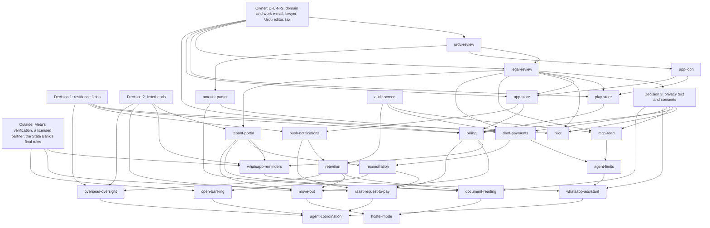

# Roadmap

What Maalik-e-Makaan does after version 1.0: three milestones and 25 items, with one plan per item
in this folder.

The roadmap is code. [`.github/roadmap.toml`](../../.github/roadmap.toml) lists the milestones and
their items. When it changes on `main`, the [Roadmap workflow](../../.github/workflows/roadmap.yml)
runs [`sync_roadmap.py`](../../tool/github/sync_roadmap.py), which creates a GitHub milestone for
each milestone and an issue labelled `roadmap` for each item, and the website's
[roadmap page](https://maalik-e-makaan-site.vercel.app/roadmap/) shows them.

GitHub's issues and milestones are the live record: who is working on what, the discussion, and
whether an item is done. The sync creates each issue once, from its `body` in the file, and never
rewrites it. The plans here record each item's design as researched on 11 November 2026, updated
with the owner's answers of 12 November 2026; a pull request that changes an item's design updates
its plan. An issue's **Done when** checklist is its
plan's list, copied unchanged when the issue is created; if the plan's list changes later, the
plan's list is the one to meet before the issue is closed.

How to read a plan:

- Every plan has the same sections: why it matters; what is true now, with sources; the design, and
  how each of the owner's three decisions changes it; the work as pull requests; what it depends on
  and unblocks; risks; a **Done when** checklist; and the questions only the owner can answer.
- **S** is up to two days of work and **M** up to about a week. Anything longer was split into S and
  M pull requests before it was written down. **Owner** marks work that is not a pull request:
  accounts, contracts and reviews.
- Repository facts link to the file. External facts marked _(summary)_ were read only through a
  search engine's summary, because the primary page could not be fetched; see
  [Before relying on a summary](#before-relying-on-a-summary).

## Milestones

| Milestone                        | Due              | Items | Pull requests   | Owner actions |
| -------------------------------- | ---------------- | ----: | --------------- | ------------: |
| **Launch and listen** (`launch`) | 28 February 2027 |    11 | 75 (30 S, 45 M) |            18 |
| **The assistant** (`assistant`)  | 30 November 2027 |    10 | 81 (39 S, 42 M) |             2 |
| **Money that moves** (`money`)   | 30 November 2028 |     4 | 35 (10 S, 25 M) |             4 |

### Launch and listen, due 28 February 2027

Get into the stores, get the Urdu and the legal texts reviewed, and put the app in the hands of the
first landlords. Paperwork holds this milestone back more than code. AR LABS needs a D-U-N-S number,
which Dun & Bradstreet issues free within 30 business days "in most cases"
([D&B](https://www.dnb.com/en-us/smb/duns/get-a-duns.html)); a domain of its own with work e-mail,
because Apple enrols an organisation only if its website's domain is associated with it
([Apple Developer, Enroll](https://developer.apple.com/programs/enroll/)); a Pakistani lawyer; and a
native Urdu editor.

| Plan                                                                                             | Pull requests | Owner | Note                                                                                                |
| ------------------------------------------------------------------------------------------------ | ------------- | ----: | --------------------------------------------------------------------------------------------------- |
| [Publish the Android app on Google Play](play-store.md)                                          | 6 S, 1 M      |     4 | Waits on the D-U-N-S number; the application ID and signing key are settled before the first upload |
| [Publish the iPhone app on the App Store](app-store.md)                                          | 3 S, 3 M      |     4 | Waits on the D-U-N-S number and a domain of AR LABS's own                                           |
| [A native speaker's review of every Urdu string](urdu-review.md)                                 | 3 S, 3 M      |     2 | The glossary and style sheet come before any editor; the font is decided (D-19), readers confirm    |
| [A lawyer's review of the privacy notice and terms](legal-review.md)                             | 3 S, 5 M      |     1 | A fixed-fee quote from two or three firms; the notice for decision 3 is approved first              |
| [The app's own icon and store artwork](app-icon.md)                                              | 1 S, 4 M      |     1 | One vector master generates every icon; screenshots come from code with fictional data              |
| [Paid plans, with early-access users told first](billing.md)                                     | 11 M          |     2 | A charge before 28 February 2027 needs the 60-day notice sent by 30 December 2026                   |
| [A screen that shows who changed what](audit-screen.md)                                          | 3 S, 4 M      |     0 | Must exist before any assistant can write                                                           |
| [A read-only MCP server, so a landlord's own AI can read their ledger](mcp-read.md)              | 2 S, 5 M      |     1 | May move to The assistant while Supabase's OAuth server is in beta                                  |
| [Draft a payment from a voice note or a pasted SMS, always confirmed](draft-payments.md)         | 2 S, 5 M      |     0 | The text path is for launch; voice notes and screenshots may move to The assistant                  |
| [A tested reader for amounts in Urdu numerals, lakh and crore, and Roman Urdu](amount-parser.md) | 3 S, 3 M      |     1 | Every amount read from a message or a voice note comes from it                                      |
| [A pilot with the first landlords](pilot.md)                                                     | 4 S, 1 M      |     2 | December 2026 to February 2027, over two rent cycles, at home and abroad                            |

### The assistant, due 30 November 2027

Munshi, an assistant that drafts while the landlord confirms: on WhatsApp, for tenants, and for the
paperwork. Four pieces in the database carry the milestone, and matter more than which language
model is chosen: grants and mandates scoped per portfolio ([mcp-read](mcp-read.md) and
[agent-limits](agent-limits.md)); assistant writes marked in the audit trail
([audit-screen](audit-screen.md)); one deterministic amount grammar for Dart and TypeScript
([amount-parser](amount-parser.md)); and outbound queues for push and WhatsApp
([push-notifications](push-notifications.md) and [whatsapp-reminders](whatsapp-reminders.md)).

| Plan                                                                                    | Pull requests | Owner | Note                                                                            |
| --------------------------------------------------------------------------------------- | ------------- | ----: | ------------------------------------------------------------------------------- |
| [A WhatsApp assistant, with voice notes](whatsapp-assistant.md)                         | 4 S, 5 M      |     0 | Rests on five other items, so it starts last; every write is a draft to confirm |
| [Scheduled reminders through the WhatsApp Business Platform](whatsapp-reminders.md)     | 4 S, 4 M      |     1 | Meta's verification of AR LABS takes weeks; revisits D-11 (proposal P-01)       |
| [An agent role that writes only within set limits](agent-limits.md)                     | 5 S, 4 M      |     0 | First half of 2027; an assistant is a person's delegate, not a fifth role       |
| [A read-only link for tenants](tenant-portal.md)                                        | 4 S, 4 M      |     0 | One revocable link per tenancy; no analytics on the page                        |
| [Suggested matches between incoming payments and open dues](reconciliation.md)          | 2 S, 6 M      |     0 | Statements are read on the phone; only credits the landlord keeps are uploaded  |
| [Read CNICs and agreements on the phone, with masking and consent](document-reading.md) | 4 S, 5 M      |     0 | Every CNIC digit is masked before anything leaves the phone                     |
| [Hostel and PG mode](hostel-mode.md)                                                    | 4 S, 4 M      |     0 | One action records the month for every bed, with a receipt each                 |
| [Push notifications](push-notifications.md)                                             | 5 S, 4 M      |     1 | First half of 2027; Android and the web before the iPhone                       |
| [Remove identity documents automatically after a tenancy ends](retention.md)            | 4 S, 2 M      |     0 | Must agree one redaction mechanism with the audit trail's seals                 |
| [A move-out photo checklist](move-out.md)                                               | 3 S, 4 M      |     0 | Records what both sides saw; it does not decide what may be deducted            |

### Money that moves, due 30 November 2028

Collect rent, not just record it, through licensed partners on Pakistan's payment rails, and give
owners abroad an assistant that watches for them. The State Bank and a licensed partner set the
pace, except for the oversight rules, which need neither.

| Plan                                                                                          | Pull requests | Owner | Note                                                                                           |
| --------------------------------------------------------------------------------------------- | ------------- | ----: | ---------------------------------------------------------------------------------------------- |
| [Collect rent with Raast Request-to-Pay, through a licensed partner](raast-request-to-pay.md) | 1 S, 7 M      |     2 | A partner contract and a legal opinion first; ends "record, not process" (proposal P-02)       |
| [Bank account data through open banking](open-banking.md)                                     | 2 S, 6 M      |     2 | The response to the State Bank's draft is due 30 November 2026; the rest waits for final rules |
| [An oversight assistant for owners abroad](overseas-oversight.md)                             | 4 S, 7 M      |     0 | Fixed rules, no model; recommended for the second half of 2027                                 |
| [Landlord, tenant and caretaker assistants that work together](agent-coordination.md)         | 3 S, 5 M      |     0 | The last item; its second phase only when an outside agent wants it                            |

## The owner's three decisions

On 11 November 2026 the owner decided three things that reach into most items. They are recorded as
D-16, D-17 and D-18 in [`PROJECT.md`](../../.planning/PROJECT.md). None of them is a roadmap item,
so the foundation work each needs is listed here, and the plans depend on it by name ("the residence
fields of decision 1"). Each plan has a section for every decision that changes it.

On 12 November 2026 the owner answered eight questions about them: the caretaker, the currency and
the owner-abroad question (decision 1); where a letterhead is set, an Urdu letterhead, the receipt
size and which plans have letterheads (decision 2); and where PostHog and Customer.io handle data
(decision 3).

Each subsection below opens with what the owner decided, then says what is true today. The design
that follows is the research's proposal, which the plans follow, except where it says the owner
decided; the owner can still change the rest, and the questions left open are under
[Decisions the owner still has to make](#decisions-the-owner-still-has-to-make).

### Decision 1: residence, per person and per portfolio (D-16)

Resident and overseas owners are told apart in two places. For each person, the country of residence
and the time zone, which the person declares and the app never infers. For each portfolio, whether
its owner lives abroad and who their caretaker is.

On 12 November 2026 the owner decided three details. The caretaker is always someone who uses the
app: a member with the `manager` role, never only a name and a phone number. Amounts stay in rupees
at launch: owners abroad see no converted or "indicative" total in another currency, because there
is no free official API for rupee rates (the ECB publishes no PKR rate, and the State Bank
publishes web pages, not an API), so conversion waits until a rate source is chosen; the owner's
own time zone and the dual time are still shown. And when a portfolio is created, the app asks
"Does the owner of these properties live abroad?" with no answer chosen, and the person must
choose; it is never filled in from the creator's residence, because the creator is often a
caretaker or a relative.

Today `profiles` holds an e-mail address, a name, a phone number and a language, and a portfolio has
no owner-abroad flag: a caretaker is simply a member with the `manager` role
([identity migration](../../supabase/migrations/20261103192722_identity_portfolios.sql)). The whole
system runs on Pakistan time, through `app.today_pkt()`
([foundation migration](../../supabase/migrations/20261103192528_foundation.sql)) and a fixed offset
in [`calendar_date.dart`](../../packages/mm_core/lib/src/time/calendar_date.dart).

The design:

- **On `profiles`:** `residence_country` (ISO 3166-1 alpha-2, empty for "not stated") and
  `time_zone` (an IANA name, checked by a function). The device's time zone may pre-fill a
  suggestion. A +92 number, the store country, the IP address, the app's language and the payment
  currency are never read as residence. Nationality and immigration status are never stored, and
  residence is never shown to tenants. There is no `display_currency` at launch (decided).
- **On `portfolios`:** `owner_abroad`, always set by an explicit choice when the portfolio is
  created, with no answer chosen in advance and never filled in from the creator's residence
  (decided); `caretaker_user_id`, a member with the `manager` role, cleared when that membership
  ends; and `caretaker_since`. Every change is audited. The caretaker is always someone who uses the
  app (decided), so there is no caretaker who is only a name and a phone number.
- **Time:** ledger dates, due dates, police deadlines, the tax year and every message to tenants
  stay on Pakistan time. An owner's alerts, digests and quiet hours follow their own time zone, and
  an owner abroad sees both times: "3:15 pm in Lahore (10:15 am in London)".
- **Money** is shown in rupees only at launch (decided): no converted or indicative total in
  another currency.

| Foundation work                                                                                                                                                                        | Size |
| -------------------------------------------------------------------------------------------------------------------------------------------------------------------------------------- | ---- |
| Residence country and time zone on `profiles`, with the validation function, column grants, pgTAP and identity contract vectors                                                        | S    |
| `owner_abroad`, `caretaker_user_id` with its trigger, and `caretaker_since`; audit triggers, rows in the RLS matrix, an upgrade test and the `mm_core` model                           | M    |
| A time-zone utility in `mm_core` for owner-local send windows, quiet hours and dual times, with vectors across the UK and US clock changes                                             | M    |
| Onboarding ("Do you live in Pakistan?"), the owner-abroad question on a new portfolio with no answer chosen, and settings for country and time zone, in English and Urdu, with goldens | M    |
| Caretaker wording in both ARB files; the plan suggestion, where the store sets the price and declared residence only suggests a plan                                                   | S    |
| The privacy page and the data export; the caretaker in [`permissions.md`](../architecture/permissions.md)                                                                              | S    |

**Later, not at launch:** a total in the owner's own currency, for display only, labelled indicative
with the rate's date and source, and a `display_currency` (ISO 4217) on `profiles` to choose it.
It waits until the owner chooses a rate source, for the reason above. The work then is the column
and its setting, the rate's source, a cache and the label (M).

Where it lands: [billing](billing.md) attaches plans to portfolios, not store accounts;
[push-notifications](push-notifications.md) keeps quiet hours and the digest in each person's zone;
[overseas-oversight](overseas-oversight.md) starts from `owner_abroad` and the caretaker;
[pilot](pilot.md) recruits by declared residence and schedules sessions in each participant's own
time; [agent-limits](agent-limits.md) and [move-out](move-out.md) let an owner approve what a
caretaker does; [tenant-portal](tenant-portal.md) never shows residence; and
[play-store](play-store.md), [app-store](app-store.md) and [app-icon](app-icon.md) never read the
store country as residence and show both kinds of owner in the screenshots.

### Decision 2: letterheads on every generated document (D-17)

Owners can upload a letterhead or make one with a simple builder, and it is applied to every PDF and
image the app generates. An upload is a PDF, whose first page is used for the first page and whose
second for later pages, or a PNG or JPG. Word users save their letterhead as a PDF.

On 12 November 2026 the owner decided four details. A letterhead is set per portfolio, not per
account, because the portfolio is the issuer on its receipts, and one upload can be copied to the
owner's other portfolios. Each portfolio may add an optional Urdu version of its letterhead:
documents issued in Urdu use it when it exists, and the main letterhead otherwise, and the builder
can make both from the same logo and details. Each portfolio chooses A5 or A4 receipts, with A5 by
default as today; an A4 letterhead on an A5 receipt is scaled down, and the preview warns when its
text becomes too small to read. And letterheads, both the builder and uploads, are on every plan,
Free included.

Today every document is a PDF made on the device with `pdf` 3.13.1, an A5 receipt and A4 statements,
and its only branding is an issuer line
([ledger_pdfs.dart](../../app/lib/src/features/ledger/presentation/pdf/ledger_pdfs.dart),
[report_pdfs.dart](../../app/lib/src/features/insights/presentation/report_pdfs.dart)). That package
can paint an image behind every page but cannot import a page from another PDF
([pdf](https://pub.dev/packages/pdf)), so a PDF letterhead is drawn as an image.

The design:

- **Uploads:** images are re-encoded on the device, which drops location and other metadata. A PDF
  goes to a `letterhead-ingest` Edge Function, which refuses encrypted files, more than two pages,
  unusual page sizes and active content (scripts, launch actions, embedded files, forms), rebuilds a
  clean two-page PDF and deletes the original.
- **Rendering:** the device turns the clean pages into images once, at about 200 dpi, with
  [pdfrx](https://pub.dev/packages/pdfrx), and caches them. The owner adjusts the safe content area,
  which is stored in points. One page theme serves every PDF builder, and an image export is a
  rendering of the finished PDF page, so letterhead and shaped Urdu come out the same in both.
- **Storage:** a private `letterheads` bucket and an audited `letterheads` table, with a main
  letterhead and an optional Urdu one per portfolio (decided: the portfolio is the issuer on a
  receipt). One upload can be copied to the owner's other portfolios (decided). Portfolio deletion
  and the storage cleanup learn the new bucket, since both name only `documents` today
  ([storage.ts](../../supabase/functions/_shared/storage.ts)).
- **Language and paper size:** a document issued in Urdu uses the portfolio's Urdu letterhead when
  it has one, and the main letterhead otherwise. Receipts are A5 or A4, as the portfolio chooses,
  A5 by default; an A4 letterhead on an A5 receipt is scaled down, and the preview warns when its
  text becomes too small to read (decided).
- **Plans:** letterheads, the builder and uploads alike, are on every plan, Free included
  (decided), so no entitlement check gates them.
- **Receipts sent by the server** (WhatsApp, the tenant's link, a partner payment) are the
  letterheaded file the app stores as a `receipt` document when a payment is confirmed.
- **Order:** builder and image letterheads first, then PDF uploads.

| Foundation work                                                                                                                                                                        | Size |
| -------------------------------------------------------------------------------------------------------------------------------------------------------------------------------------- | ---- |
| The `letterheads` table, a private bucket with type and size limits, RLS, audit, and a main and an optional Urdu letterhead per portfolio; cleanup and deletion extended to the bucket | M    |
| The shared page theme in the ledger and report PDFs, page numbers inside the safe area, the first PDF image goldens (A4 and A5, English and Urdu) and a file-size test                 | M    |
| The builder, with a live preview, making the main and the Urdu letterhead from the same logo and details                                                                               | M    |
| Copying a letterhead to the owner's other portfolios                                                                                                                                   | S    |
| The receipt size per portfolio (A5 by default, or A4); an A4 letterhead scaled onto an A5 receipt, with the preview's warning when its text is too small to read                       | M    |
| Image letterheads: re-encoding, aspect and resolution checks, header and footer bands                                                                                                  | S    |
| `letterhead-ingest`, first half: validation, tested with hostile files (scripts, embedded files, encryption, 50 pages, 30 MB)                                                          | M    |
| `letterhead-ingest`, second half: the rebuild                                                                                                                                          | M    |
| Rasterising and caching; on the web, pdfrx's WASM file served from the app's own origin and loaded only when needed                                                                    | M    |
| Safe-area detection and the adjustment screen                                                                                                                                          | M    |
| Image exports through the PDF renderer                                                                                                                                                 | S    |

Where it lands: [tenant-portal](tenant-portal.md), [whatsapp-reminders](whatsapp-reminders.md) and
[raast-request-to-pay](raast-request-to-pay.md) serve the stored receipt; [move-out](move-out.md)
prints the report and settlement on it, with a "for and on behalf of the owner, through attorney"
block when a caretaker signs; [overseas-oversight](overseas-oversight.md) prints the evidence pack
on it; [hostel-mode](hostel-mode.md) makes 38 letterheaded receipts in one action, the size test;
[billing](billing.md) puts letterheads on every plan, Free included; [legal-review](legal-review.md)
adds the owner's warranty for what they upload; and [urdu-review](urdu-review.md) reviews the
builder's labels and error messages, the Urdu letterhead and the small-text warning.

### Decision 3: privacy-first analytics, support and e-mail (D-18)

- **Website:** PostHog, cookieless and anonymous, said plainly on the privacy page.
- **App:** PostHog and Intercom only after the person opts in.
- **E-mail:** Customer.io for transactional e-mail, and for lifecycle e-mail to people who consent.

On 12 November 2026 the owner decided where these processors handle data: the existing accounts
stay, PostHog's US Cloud organisation and Customer.io's US workspace, which is on Customer.io's
Startup plan. The privacy notice names the US as where they handle data, under their standard
data-transfer terms. This replaces the research's suggestion of PostHog's EU Cloud. The rest of the
research's design is unchanged and still applies: cookieless mode on the website; opt-in only in
the app; no replay, autocapture, surveys or feature flags; the objection switch and Do Not Track.
The same day, at the owner's request, Maalik-e-Makaan got its own PostHog project in that
organisation (project 730301), set up to match: session recording, heatmaps, console-log capture,
dead-click capture, autocapture and surveys off, client IP addresses discarded, and cookieless
tracking on.

Today the privacy page promises the opposite, in English and Urdu: "This website sets no cookies,
uses no analytics or trackers" and "The app has no advertising, no analytics and no trackers"
([privacy.md](../../website/src/content/pages/en/privacy.md)). The website's content security policy
allows scripts and connections to its own origin only ([vercel.json](../../website/vercel.json)).
The owner's decision withdraws that promise. Doing so is a matter of trust, not of configuration,
so the research recommends this order of work: rewrite the text and have the lawyer review it,
record consent, and only then add the SDKs.

The design:

- **Website:** Maalik-e-Makaan's PostHog project in the US Cloud (decided) with
  `cookieless_mode: 'always'`,
  which writes no cookie or browser storage and counts visitors with a server-side hash whose salt
  is deleted daily
  ([PostHog cookieless tutorial](https://posthog.com/tutorials/cookieless-tracking)). The slim build
  is bundled as a first-party module; requests go through Vercel rewrites on the site's own origin;
  query strings are stripped, so calculator inputs never leave; there is no replay, autocapture,
  survey or feature flag. Visitors can object on the privacy page, and Do Not Track is honoured.
- **Recording off everywhere:** the SDK configuration on the website and in the app turns off
  session recording, heatmaps, console-log capture and dead-click capture, and the same settings
  are off in the PostHog project (done when it was created, 12 November 2026).
- **App:** a `consents` table and a Privacy section in Settings with three switches, all off at
  first: analytics, support chat and lifecycle e-mail. PostHog starts opted out, on the same US
  project, with a scrubber that drops names, phone numbers, CNICs, IBANs and amounts. Intercom
  starts only after support-chat consent, with a signed token from an Edge Function, and not on the
  web at launch.
- **E-mail:** account, invitation, receipt, security and contractual messages go through
  Customer.io's transactional path, on the existing US workspace (decided), with link tracking off;
  lifecycle mail goes only to people who consented, and an unsubscribe is written back to
  `consents`. Auth e-mail stays on Resend for launch. The 60-day notice before billing starts is a
  contractual message, sent to every early-access user whatever their marketing consent.
- **Measurement** for the pilot and billing comes from aggregates of database rows on the server, so
  the opt-in rule costs no product insight. No plan sends an amount, a name, a phone number, a CNIC
  or a record's content to analytics.
- **One consent shape** (subject, purpose, text version, granted and withdrawn times, method,
  evidence, who recorded it) in two tables split by subject: `consents` for account holders
  (analytics, support chat, lifecycle e-mail, AI providers) and `tenant_consents` for tenants
  (document reading, WhatsApp opt-in, Raast requests). The agent grants of [mcp-read](mcp-read.md)
  and mandates of [agent-limits](agent-limits.md) follow it too. The privacy notice, the data export
  and the deletion fan-out read the same columns.

| Foundation work                                                                                                                                                                                                                        | Size      |
| -------------------------------------------------------------------------------------------------------------------------------------------------------------------------------------------------------------------------------------- | --------- |
| The privacy notice, FAQ, footer, README and `website/AGENTS.md` rewritten in English and Urdu (processors, the US as where PostHog and Customer.io handle data, retention, how to object), approved in [legal-review](legal-review.md) | S         |
| The `consents` table, own-row RLS, a write RPC and audit; the consent screen and Privacy settings, with widget and pgTAP tests                                                                                                         | M         |
| Account deletion fans out to PostHog, Intercom and Customer.io, retried without holding up the deletion                                                                                                                                | M         |
| The PostHog project's settings (recording, heatmaps, console-log and dead-click capture off; done 12 November 2026) and the data processing agreement                                                                                  | Owner     |
| The slim posthog-js on the website with recording, heatmaps and console-log and dead-click capture off, the rewrites, a browser test that fails on any CSP or Trusted Types violation, performance budgets                             | M         |
| Preview checks: whether PostHog sees the visitor's IP through the rewrite (if not, only page views can be counted), and POST redirects                                                                                                 | S         |
| The objection switch and Do Not Track                                                                                                                                                                                                  | S         |
| `posthog_flutter` behind an analytics wrapper: opt-in, the scrubber, session recording off, a pseudonymous identity that is not the account's id                                                                                       | M         |
| The Flutter web app: PostHog started from the app's own files with a CSP change, or no analytics on the web                                                                                                                            | S         |
| A list of about 20 events, none carrying an amount or a name                                                                                                                                                                           | S         |
| The Intercom workspace: region, languages, a Help Center in English and Urdu                                                                                                                                                           | Owner     |
| The `intercom-token` function; Intercom started after consent, and logged out on sign-out and withdrawal                                                                                                                               | M         |
| The sending subdomains for Customer.io's existing US workspace, SPF, DKIM and DMARC                                                                                                                                                    | Owner + S |
| The `cio-sync` outbox and function; the unsubscribe webhook                                                                                                                                                                            | M         |
| Urdu e-mail templates, right to left with amounts kept left to right, checked in Gmail and Outlook                                                                                                                                     | M         |

Where it lands: [legal-review](legal-review.md) reviews the new notice before any SDK ships;
[play-store](play-store.md) and [app-store](app-store.md) declare even the opt-in collection in Data
safety and App Privacy; [billing](billing.md) sends its notice through the transactional path and no
purchase event to analytics; [pilot](pilot.md) measures from server aggregates;
[tenant-portal](tenant-portal.md) runs no analytics at all;
[overseas-oversight](overseas-oversight.md) sends its digest as a service message; and
[mcp-read](mcp-read.md), [draft-payments](draft-payments.md),
[whatsapp-assistant](whatsapp-assistant.md) and [document-reading](document-reading.md) send nothing
to an AI or OCR provider before the person's explicit consent, as Apple's guideline 5.1.2(i)
requires ([App Review Guidelines](https://developer.apple.com/app-store/review/guidelines/)).

## Order of work

An arrow means "must come before". Each item points to the items whose plans name it as a
dependency, leaving out arrows that follow from others and those that only a later part of an item
needs (Munshi's wording of oversight findings, for example). Three loose links are left out because
they run both ways: pilot readers to confirm the Urdu font, pilot testers on the stores' test tracks,
and the drafts the lawyer reads from [billing](billing.md), [retention](retention.md) and
[move-out](move-out.md). The [pilot](pilot.md) also informs billing's plans and prices without
holding it up, so no arrow joins them.

The waves follow from the graph and the calendar. Wave 0 matters most: every later date assumes it
starts in November 2026.

| Wave | When                           | Pull requests                                                                                                                                                                                                                                                                                                                                                                                      | Owner actions                                                                                                                                                                                                                                                    | Gate to the next wave               |
| ---- | ------------------------------ | -------------------------------------------------------------------------------------------------------------------------------------------------------------------------------------------------------------------------------------------------------------------------------------------------------------------------------------------------------------------------------------------------- | ---------------------------------------------------------------------------------------------------------------------------------------------------------------------------------------------------------------------------------------------------------------- | ----------------------------------- |
| 0    | 11 to 30 November 2026         | The decision entries (D-16 to D-18, recorded); the privacy draft and the `consents` table (decision 3); the residence fields (decision 1); the audit feed; the amount lexicon and vectors                                                                                                                                                                                                          | Chase the D-U-N-S number; buy the domain and set up work e-mail; start Apple's enrolment; send the lawyer's request for quotation; shortlist editors and agree the glossary; **answer the State Bank by 30 November**; choose the icon's mark; recruit the pilot | The D-U-N-S number; the domain live |
| 1    | December 2026 to February 2027 | The audit screens; the amount grammar; the Urdu corrections; the app icon; the Play and App Store pipelines; pilot feedback and metrics; website analytics and the app's PostHog, once the lawyer approves the notice; builder and image letterheads; billing's schema and limits, and its web checkout only if charging before 28 February; the text path of draft-payments; a spike for mcp-read | The lawyer's and the editor's reviews; the Play and Apple accounts; tax registration and a payment provider; **the early-access notice by 30 December 2026** if anyone is to be charged before 28 February; the pilot sessions                                   | Both stores live; the pilot report  |
| 2    | March to June 2027             | Billing's store checkout, and its web checkout unless it came in wave 1; PDF letterheads; push-notifications; tenant-portal; agent-limits; mcp-read if the OAuth server is ready; retention; Intercom; Customer.io's sync and templates                                                                                                                                                            | Meta's verification and templates; Firebase and APNs; the retention period, with the lawyer; the choice of model and speech-to-text providers                                                                                                                    | Mandates enforced; push live        |
| 3    | July to November 2027          | whatsapp-reminders; whatsapp-assistant; reconciliation; document-reading; move-out; hostel-mode; the overseas-oversight rules, brought forward from 2028                                                                                                                                                                                                                                           | Template approvals; what a caretaker may see of the oversight findings                                                                                                                                                                                           | The assistant milestone             |
| 4    | 2028                           | raast-request-to-pay; open-banking; the oversight evidence pack and Munshi's wording of findings; the first phase of agent-coordination                                                                                                                                                                                                                                                            | A partner contract and a legal opinion; the State Bank's final rules; licensed providers                                                                                                                                                                         | The money milestone                 |

Three changes to the milestones are recommended but not made:

- Build the overseas-oversight rules in 2027, because they need no regulator or partner and are the
  clearest reason the Overseas plan exists.
- Let [mcp-read](mcp-read.md), and the voice and screenshot parts of
  [draft-payments](draft-payments.md), move to The assistant rather than hold up the launch.
- Let [billing](billing.md)'s checkout move to The assistant. In the waves above, only its schema
  and limits are built before 28 February 2027, and the store and web checkout come after the
  launch milestone is due. The exception is a charge before 28 February: then the web checkout
  comes into wave 1, with the early-access notice sent by 30 December 2026, the tax registration
  and a payment provider's agreement in place. It need not wait for the pilot's report, which
  informs prices but does not hold up the code; the store checkout still follows in wave 2.

## Decisions the owner still has to make

The most urgent first. Each plan ends with its own questions; these are the ones that hold up other
work or have a date.

| When                                             | Decision                                                                                                           | Items                                                                                                                                              | Recommendation                                                                                                                                                                                         |
| ------------------------------------------------ | ------------------------------------------------------------------------------------------------------------------ | -------------------------------------------------------------------------------------------------------------------------------------------------- | ------------------------------------------------------------------------------------------------------------------------------------------------------------------------------------------------------ |
| **By 30 November 2026**                          | Respond to the State Bank's draft open-banking regulations?                                                        | [open-banking](open-banking.md), [reconciliation](reconciliation.md)                                                                               | Yes: two pages asking for the remitter's name and the transfer reference in transaction data, a proportionate read-only category, consent limited to credits, and rules for joint accounts             |
| **Now**                                          | When the pilot starts, its size and split, where it runs, the Urdu moderator, incentives                           | [pilot](pilot.md)                                                                                                                                  | Recruit from late November so December, January and February rents are covered; 15 to 25 landlords, about a third abroad; real data only once the notice covers tenants                                |
| **Now**                                          | Chase the D-U-N-S number; make the D&B name and address match the SECP record exactly; the public developer name   | [play-store](play-store.md), [app-store](app-store.md), [billing](billing.md)                                                                      | Start today                                                                                                                                                                                            |
| **Now**                                          | A domain and work e-mail; move both sites to it                                                                    | [app-store](app-store.md), [whatsapp-reminders](whatsapp-reminders.md), e-mail DNS, links that open the app                                        | Buy now: it unblocks Apple, Meta's verification and e-mail authentication at once                                                                                                                      |
| **Now**                                          | The lawyer's budget and request for quotation; whether AR LABS accepts the processor role; the city for disputes   | [legal-review](legal-review.md) and everything after it                                                                                            | Send the request this month, with a deadline at least six weeks before the store submissions                                                                                                           |
| Before the first Play upload                     | The application ID and the signing key; sideloaded copies; countries; category; the financial-features declaration | [play-store](play-store.md)                                                                                                                        | Settle the ID first, since it can never change after the upload; if it stays, upload the existing release key so the sideloaded app updates in place; declare no financial features; Business category |
| Before pilot round 1                             | Urdu digits, loanwords                                                                                             | [urdu-review](urdu-review.md), [pilot](pilot.md)                                                                                                   | Settle the glossary; the font is D-19, confirmed with readers                                                                                                                                          |
| **By 30 December 2026**, if charging in February | When billing starts; tax registration; the payment provider; plans per portfolio; half price in the stores         | [billing](billing.md)                                                                                                                              | Plans per portfolio; web checkout first; one rule everywhere                                                                                                                                           |
| Before store artwork                             | The icon's mark; iPhone only or iPad too; EU storefronts                                                           | [app-icon](app-icon.md), [app-store](app-store.md)                                                                                                 | No text in the mark; iPhone only at launch unless iPad layouts are reviewed                                                                                                                            |
| Before Intercom                                  | Intercom after its sale to Salesforce; startup terms; chat on the web                                              | Decision 3                                                                                                                                         | Keep support behind the app's own Help screen so the vendor can change; no web chat at launch                                                                                                          |
| Before letterheads ship                          | Upload limits; image letterheads at launch                                                                         | Decision 2                                                                                                                                         | Images at launch; builder and image letterheads first                                                                                                                                                  |
| Before onboarding ships                          | Co-owners; residence and price                                                                                     | Decision 1                                                                                                                                         | Leave residence empty until stated; the store alone sets the price                                                                                                                                     |
| With the lawyer                                  | How long identity documents are kept, and holds; agreement and police-form images                                  | [retention](retention.md)                                                                                                                          | Between 3 and 12 months, held automatically while rent is outstanding                                                                                                                                  |
| Before an assistant writes, 2027                 | Model and speech-to-text providers; whether data may leave Pakistan                                                | [draft-payments](draft-payments.md), [whatsapp-assistant](whatsapp-assistant.md), [document-reading](document-reading.md), [mcp-read](mcp-read.md) | On the device where possible; any cloud provider with no retention, explicit consent and a line in the notice                                                                                          |
| 2027                                             | WhatsApp costs, the signature on reminders, a fallback provider, a Roman Urdu variant                              | [whatsapp-reminders](whatsapp-reminders.md)                                                                                                        | A monthly cap in the plan; the owner chooses the signature                                                                                                                                             |
| 2027                                             | Caretakers' mandates, the longest mandate, skipping the tap, the budget after voids; MCP's price and expiry        | [agent-limits](agent-limits.md), [mcp-read](mcp-read.md)                                                                                           | An owner approves a caretaker's mandate; every write is confirmed at first                                                                                                                             |
| 2027                                             | Tenants: accounts or links; how long a link lasts; disputes                                                        | [tenant-portal](tenant-portal.md), [agent-coordination](agent-coordination.md), [legal-review](legal-review.md)                                    | Links first                                                                                                                                                                                            |
| 2027                                             | Oversight thresholds; what a caretaker sees; several owners; when the evidence pack comes                          | [overseas-oversight](overseas-oversight.md)                                                                                                        | Bring the rules forward; caretakers see their to-dos                                                                                                                                                   |
| 2027                                             | Hostel mess charges, advances, pricing by room or by bed                                                           | [hostel-mode](hostel-mode.md)                                                                                                                      | A flat monthly mess charge; rent per bed                                                                                                                                                               |
| 2028                                             | The partner model, the first partner, who pays the merchant fees, whether it is a Business feature                 | [raast-request-to-pay](raast-request-to-pay.md)                                                                                                    | The partner model only, settling to the landlord, with a legal opinion first                                                                                                                           |

Settled by the owner on 12 November 2026, and recorded in D-16 to D-18 in
[`PROJECT.md`](../../.planning/PROJECT.md) and in the decisions above:

- **Decision 1, before onboarding:** `owner_abroad` is never pre-filled; the question is asked with
  no answer chosen. Every caretaker uses the app, as a member with the `manager` role. Amounts are
  in rupees only at launch, with no `display_currency`; conversion waits until a rate source is
  chosen.
- **Decision 2, before letterheads ship:** per portfolio, and one upload can be copied to the
  owner's other portfolios; an optional Urdu letterhead; A5 or A4 receipts per portfolio, A5 by
  default; on every plan, Free included.
- **Decision 3, before any analytics SDK ships or any profile is sent:** PostHog's existing US
  Cloud organisation, with a project of Maalik-e-Makaan's own, and Customer.io's existing US
  workspace stay, and the privacy notice names the US.
  EU visitors get the same cookieless counting, notice, objection switch and Do Not Track as
  everyone else, and the lawyer still weighs the residual risk ([legal-review](legal-review.md)).

## Proposals that would reverse earlier decisions

Four items would undo something already decided, through two changes. Each change is recorded as an
open proposal in [`PROJECT.md`](../../.planning/PROJECT.md), not as a decision, and becomes one only
when the owner accepts it:

- **P-01:** WhatsApp reminders sent automatically through the WhatsApp Business Platform
  ([whatsapp-reminders](whatsapp-reminders.md), and Munshi in
  [whatsapp-assistant](whatsapp-assistant.md)), against D-11, which chose free `wa.me` links sent
  from the landlord's own phone.
- **P-02:** collecting rent through a licensed partner
  ([raast-request-to-pay](raast-request-to-pay.md)) and reading bank data
  ([open-banking](open-banking.md)), against the rule that collection is recorded, not processed.

The website's promise of no analytics is not among them: the owner withdrew it with decision 3
(D-18). What remains is the new text in English and Urdu, which the research recommends the lawyer
reviews before any analytics SDK ships ([legal-review](legal-review.md)).

## Before relying on a summary

The research ran behind a network allowlist that blocked these hosts: `support.google.com`,
`sbp.org.pk`, `developers.facebook.com`, `propakistani.pk`, `techjuice.pk`, `dawn.com`,
`ycloud.com`, direct fetches from `supabase.com` and `posthog.com` (their documentation was read
from its sources on GitHub instead), `arxiv.org`, `pakistancode.gov.pk`, `punjablaws.gov.pk`, the
legal directories (Chambers, Legal 500, DLA Piper), `download.microsoft.com` and Google's fonts
blog. Facts from those hosts were read only through search summaries. Most carry _(summary)_ in
the plans, but some citations to them have no marker, because the research recorded none: treat
any link to one of these hosts as a summary, marked or not. For a host outside this list,
_(summary)_ marks the facts that were read through a search summary all the same.

Every cost built on a price (WhatsApp per landlord, the Urdu editing budget, what a store sale
nets) is an inference from that price and is no surer than it. Some facts are the project's own
published guides, which cite official texts that the research did not read again: the
police-registration deadlines, the tenancy rules and the NEPRA decisions.

Check these before relying on them:

| Area                   | What rests on summaries or secondary sources                                                                                                                                                                                                                         | Where to confirm                                                                                                                                                                                                                                                                                                                                                                                                                                          |
| ---------------------- | -------------------------------------------------------------------------------------------------------------------------------------------------------------------------------------------------------------------------------------------------------------------- | --------------------------------------------------------------------------------------------------------------------------------------------------------------------------------------------------------------------------------------------------------------------------------------------------------------------------------------------------------------------------------------------------------------------------------------------------------- |
| Google Play            | Whether organisation accounts skip the 12-tester, 14-day closed test; the account-deletion URL rules; the financial-features declaration; the SMS permission rules; Pakistan's absence from user choice billing; the 15% subscription fee outside the US, UK and EEA | Play Console Help [14151465](https://support.google.com/googleplay/android-developer/answer/14151465), [13327111](https://support.google.com/googleplay/android-developer/answer/13327111), [13849271](https://support.google.com/googleplay/android-developer/answer/13849271), [10208820](https://support.google.com/googleplay/android-developer/answer/10208820), [13821247](https://support.google.com/googleplay/android-developer/answer/13821247) |
| State Bank of Pakistan | The Request-to-Pay mandate of December 2023; the P2M subsidy; what the open-banking draft contains (the 30 November deadline agrees across four outlets); the Raast Business API licences                                                                            | The [draft regulations](https://www.sbp.org.pk/assets/document/Open_Banking_Regulations_for_Public_Consulatation_Draft.pdf) and the [circulars](https://www.sbp.org.pk/)                                                                                                                                                                                                                                                                                  |
| WhatsApp               | Pakistan's rates (US$0.015 for utility, authentication and service, US$0.0473 for marketing); the change of 1 October 2026; messaging limits; opt-in wording; the scope of the ban on general AI chatbots; verification documents                                    | Meta's pricing page and rate card                                                                                                                                                                                                                                                                                                                                                                                                                         |
| Supabase               | The OAuth 2.1 server's beta status; the `client_id` claim and RLS patterns; MCP on Edge Functions                                                                                                                                                                    | [OAuth server](https://supabase.com/docs/guides/auth/oauth-server) and the changelog                                                                                                                                                                                                                                                                                                                                                                      |
| Pakistani law          | The Personal Data Protection Bill's status and contents; PECA s.16; the Data Governance Policy; deposit rules (sources conflict); hostel reporting deadlines (3, 24 or 48 hours); rules for women's hostels; ETO s.6; which limitation article applies               | pakistancode.gov.pk, punjablaws.gov.pk and the lawyer                                                                                                                                                                                                                                                                                                                                                                                                     |
| Tax                    | Provincial sales tax on IT services for 2026–27 (sources conflict); whether the stores collect Pakistani sales tax; e-invoicing for Islamabad services                                                                                                               | A tax adviser and the Finance Acts                                                                                                                                                                                                                                                                                                                                                                                                                        |
| Payments               | Payment providers' merchant rates (from an unofficial partner guide); Safepay's fees; Play payouts to Pakistan; carrier-billing limits                                                                                                                               | Written rate cards                                                                                                                                                                                                                                                                                                                                                                                                                                        |
| Vendors                | Intercom's rename to Fin and its sale to Salesforce; Intercom's prices and startup terms; Customer.io's and PostHog's prices and startup programmes; when the UK's Data (Use and Access) Act provisions took effect; the EDPB guidelines                             | Vendor pages at sign-up; the ICO and EDPB texts                                                                                                                                                                                                                                                                                                                                                                                                           |
| AI and OCR             | ML Kit's languages; Urdu support and prices of Cloud Vision and Azure; Urdu OCR benchmarks; the status of AP2, A2A and x402; how clients treat MCP tool annotations                                                                                                  | Each vendor's documentation                                                                                                                                                                                                                                                                                                                                                                                                                               |
| Stores, other          | Apple's Urdu locale code (`ur-PK`); the D&B process in Pakistan; first-review times on both stores                                                                                                                                                                   | App Store Connect; D&B                                                                                                                                                                                                                                                                                                                                                                                                                                    |
