# User acceptance testing

End-to-end acceptance tests of the main landlord journeys: the release web build of the app in a
real browser, against a real local Supabase stack (Postgres 17, GoTrue, PostgREST, Storage, the
Edge Functions and Mailpit). Nothing is faked: sign-up e-mails are read from Mailpit, payments go
through `record_payment`, files go to the private `documents` bucket, and every journey compares
what the screens show with the database.

- Suite: [`app/uat/`](../app/uat) (Playwright, 14 journeys in
  [`tests/journeys.spec.ts`](../app/uat/tests/journeys.spec.ts)).
- Harness: [`tool/uat/run.sh`](../tool/uat/run.sh) and
  [`tool/uat/serve_app.py`](../tool/uat/serve_app.py).
- Entry points: `make test-uat`, and the `uat` job in [`ci.yml`](../.github/workflows/ci.yml).

## How it works

1. `tool/uat/run.sh` starts the stack if it is not running (`supabase start` without the services
   the app does not use, as the `supabase-stack` CI job does), or resets it with `UAT_RESET=1`
   (`supabase db reset`: every migration and the seed).
2. It builds the app (`flutter build web --release`) with a configuration pointing at the stack,
   and serves the build with production's routes and headers, Content-Security-Policy included
   (`tool/web/package_vercel.py`), changing only the backend origin to the local `http` one.
3. Playwright drives the app in Chromium at phone size (412 × 915) through Flutter's semantics
   tree: every control is found by its ARIA role and its English or Urdu label, as a screen reader
   finds it, and activated the way a screen reader activates it. A control the suite cannot find
   by role and label is one a blind landlord cannot find either.
4. The daily job's pg_cron schedule is paused for the run so that the suite decides when late fees
   appear; it runs the same function, `private.run_daily_jobs()`, itself, and resumes the
   schedule afterwards.

Each run creates its own users (`uat-<who>-<run>@example.com`), so it can be repeated on the same
stack. Test data is synthetic: no real names, CNICs, phone numbers or documents.

## Run it

```sh
make test-uat                       # start or reuse the stack, build, serve, run
UAT_RESET=1 make test-uat           # supabase db reset first
UAT_SKIP_BUILD=1 make test-uat      # reuse app/build/uat/web
UAT_SCREENSHOTS=docs/uat make test-uat   # write the report's screenshots
tool/uat/run.sh -g "J5 "            # extra arguments go to Playwright
```

It needs the Supabase CLI and Docker, Flutter, Node 22 and `psql`. The app must be served on port
8080 (`UAT_PORT`), which Auth's redirect URLs and the functions' `APP_URL` in
`supabase/config.toml` expect. The harness adds a `STORAGE_CLEANUP_TOKEN` to
`supabase/functions/.env` before the stack starts, because journey 10 calls the
`storage-cleanup` function the way pg_cron does. The Playwright report is written to
`app/uat/build/report/`.

In CI the `uat` job runs it on every push and pull request and uploads the report, the failure
traces and the screenshots. It starts its own stack and runs alongside the `supabase-stack` job,
not after it (it has no `needs:`), so a failing database suite does not hide the journeys. A full local run with the stack already up took 2 min 50 s, of which
the database reset, the web build (83 s) and the journeys (57 s); a later run reusing the build took
1 min 25 s. On a runner, starting the stack and installing Chromium should add about 5 minutes (an
estimate: the job has not run on GitHub yet).

## Results

### After the fixes

Every defect below is fixed, and the journey that found it now asserts the fix instead of
recording the fault (see [Defects](#defects), Status). Run on 2026-11-08 (Pakistan date 2026-11-09) with
`UAT_RESET=1 make test-uat`: `supabase db reset` from the repository's own `supabase/` directory
applied all 23 migrations (including the wrapped `20261108200216_identity_checks.sql` and the new
`20261109081109_uat_display_fixes.sql`) and the seed with no workaround, the web build took 98 s,
and **all 14 journeys passed** in 59.7 s (3 min 9 s in all). The screenshots in this report are
from that run, so they show the fixed screens; the tables below describe the first run.

### First run

Run on 2026-11-08 (Pakistan date 2026-11-09) at commit `e853378`, Supabase CLI 2.122.1, Chrome for
Testing 153, against `supabase db reset` (all 22 migrations and the seed). **All 14 journeys
passed** on two consecutive runs, the second without a reset. Eight defects were found; they are
listed in [Defects](#defects). D1 had to be worked around to start the stack at all (see
[Environment](#environment)).

| #   | Journey                                         | Language | Result                |
| --- | ----------------------------------------------- | -------- | --------------------- |
| J1  | Sign up and confirm the e-mail, first portfolio | English  | Pass                  |
| J2  | Add a property and a unit                       | English  | Pass (D5 seen)        |
| J3  | Add a tenant, CNIC and phone validation         | English  | Pass                  |
| J4  | Start a tenancy (back-dated, with a late fee)   | English  | Pass (D7 seen)        |
| J5  | Record a payment, receipt, PDF, ledger balance  | English  | Pass                  |
| J6  | Late fees from the daily job                    | English  | Pass (D6 seen)        |
| J7  | Invite a viewer; they sign up and accept        | Both     | Pass (D3 seen)        |
| J8  | Role limits: a viewer cannot record payments    | Urdu     | Pass                  |
| J9  | Dashboard figures match the ledger              | English  | Pass (D2 seen)        |
| J10 | Upload a document to storage, download, delete  | English  | Pass                  |
| J11 | End the tenancy                                 | English  | Pass                  |
| J12 | Switch to Urdu: dashboard, ledger, Urdu receipt | Urdu     | Pass (D4 and D8 seen) |
| J13 | Settle the deposit after the tenancy ends       | Urdu     | Pass                  |
| J14 | Account deletion: the viewer, then the owner    | Urdu     | Pass                  |

## Journeys

Amounts below are for a run between the 6th and the 10th of a month (two late rents). The suite
works out the month names, the receipt year and the number of late rents from the Pakistan date,
so it passes on any day.

### J1 Sign up in English and confirm the e-mail

Steps: open the app; Continue in English; Create account; name, e-mail and a password; Create
account; open the confirmation link from Mailpit in the same browser; name the portfolio; Create
portfolio.

| Expected                                                             | Actual                                          |
| -------------------------------------------------------------------- | ----------------------------------------------- |
| "Check your e-mail" screen; an e-mail reaches Mailpit                | As expected: "Confirm your e-mail address · …"  |
| The link signs the user in and asks for a first portfolio            | Lands on `/portfolios/new`, signed in           |
| The portfolio is created and the dashboard says there is no property | "UAT Rentals is ready." and "No properties yet" |

### J2 Add a property and a unit

Steps: Add property; name, address, city, province Punjab; Save; Add unit; name, asking rent
Rs 50,000; Save.

| Expected                                             | Actual                                                           |
| ---------------------------------------------------- | ---------------------------------------------------------------- |
| The property shows Punjab's police-registration rule | "register each tenancy with the police within 15 days"           |
| The unit is vacant from today, asking Rs 50,000      | Asking rent correct; "Vacant since 8 Nov 2026" on 9 Nov (**D5**) |

### J3 Add a tenant, with CNIC and phone validation

Steps: Add tenant; full name; CNIC `1111111111111` and phone `0300123456`; consent; Save; then a
valid CNIC and `03001234567`; Save.

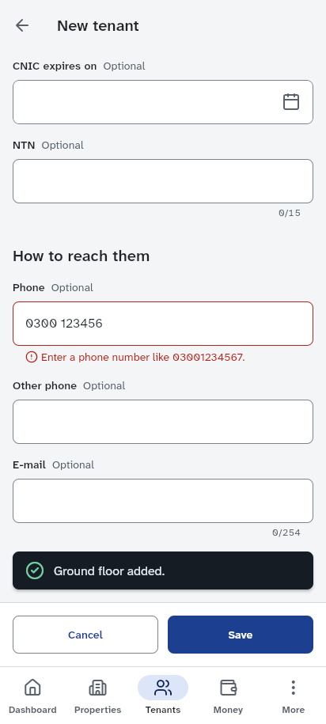

| Expected                                                    | Actual                                                            |
| ----------------------------------------------------------- | ----------------------------------------------------------------- |
| A repeated-digit CNIC and a short mobile number are refused | Both fields marked invalid (`aria-invalid`), with the hints shown |
| Valid values save; the CNIC is masked on the detail screen  | "Tenant Uat added."; CNIC read as "35202, 7 hidden digits, 1"     |

### J4 Start a tenancy

Steps: Start tenancy from the tenant; choose Gulberg House, Ground floor; move-in on the 1st two
months ago (date picker, text entry); rent Rs 50,000; deposit Rs 100,000; late fee a fixed
Rs 1,000; Start tenancy.

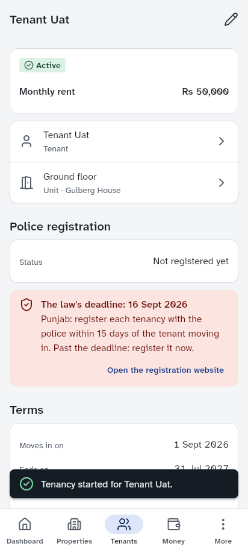

| Expected                                                            | Actual                                               |
| ------------------------------------------------------------------- | ---------------------------------------------------- |
| Dues backfilled from the billing start: three rents and the deposit | "Owed now: Rs 250,000"                               |
| Grace days 5 and the late-fee policy stored                         | "Grace days, 5 days"; "A fixed amount · Rs 1,000"    |
| The Punjab police deadline (15 days from possession) flagged        | "The law's deadline: 16 Sept 2026 … register it now" |

### J5 Record a payment, see the receipt and the ledger balance

Steps: Open the ledger; Record payment; Rs 120,000 cash with a reference; Record payment; Share
receipt; Share PDF (English); Open the ledger.

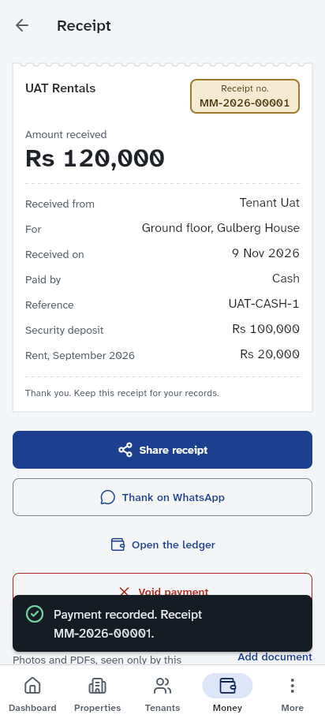

| Expected                                                | Actual                                                        |
| ------------------------------------------------------- | ------------------------------------------------------------- |
| Receipt number 1 of the year, allocated oldest first    | `MM-2026-00001`: deposit Rs 100,000, September rent Rs 20,000 |
| A one-page English PDF receipt is produced              | `receipt-MM-2026-00001.pdf`, a valid PDF of 1 page            |
| The ledger shows Rs 130,000 owed, equal to the database | "Owed now, 130000 rupees"; `sum(outstanding)` = 130000.00     |

### J6 Late fees from the daily job

Steps: run `select private.run_daily_jobs()` (the function pg_cron calls), twice; reload the app.

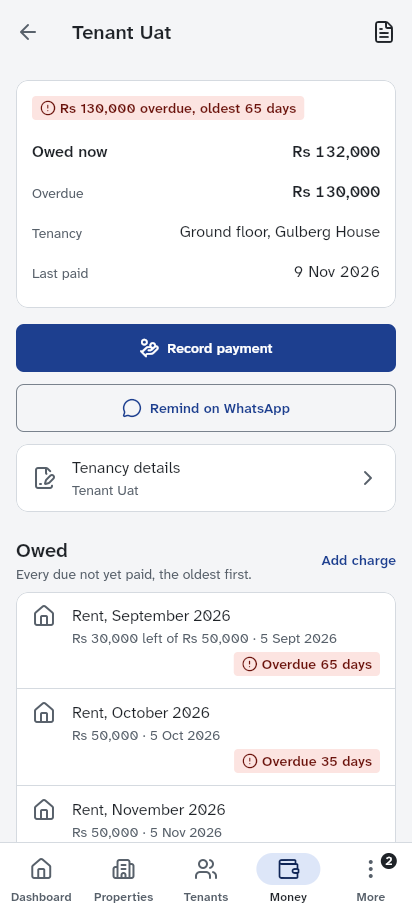

| Expected                                                              | Actual                                                      |
| --------------------------------------------------------------------- | ----------------------------------------------------------- |
| One Rs 1,000 fee per rent more than 5 days late; this month's not yet | `late_fees: 2`; the ledger lists both; total Rs 132,000     |
| A second run the same day adds nothing                                | `late_fees: 0`; the database holds 2 fees, Rs 2,000         |
| The fee reads as a late fee in the user's language                    | Its note reads "Late fee" in English, also in Urdu (**D6**) |

### J7 Invite a viewer; they sign up in Urdu and accept

Steps: More, Team, Invite someone; their e-mail; role Viewer; Send invitation; Copy link. In a
second browser: open the link; continue in Urdu; create an account; confirm the e-mail from
Mailpit.

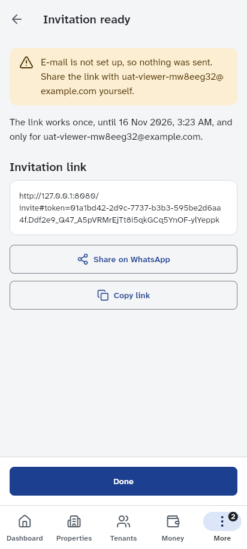

| Expected                                                       | Actual                                                                    |
| -------------------------------------------------------------- | ------------------------------------------------------------------------- |
| Without an e-mail provider, the link is shown to share by hand | "E-mail is not set up, so nothing was sent. Share the link …"             |
| The link can be read and copied                                | Copied and pasted correctly; not exposed to assistive technology (**D3**) |
| After confirming the address, the invitation is accepted       | "Welcome to UAT Rentals. You joined as viewer." (in Urdu)                 |
| The membership row has the viewer role                         | `portfolio_members.role` = `viewer`                                       |

The invitation e-mail goes through Resend, which is not configured locally, so Mailpit only
carries Auth's sign-up confirmation; the link is taken from the app, the way a landlord without
e-mail set up shares it on WhatsApp.

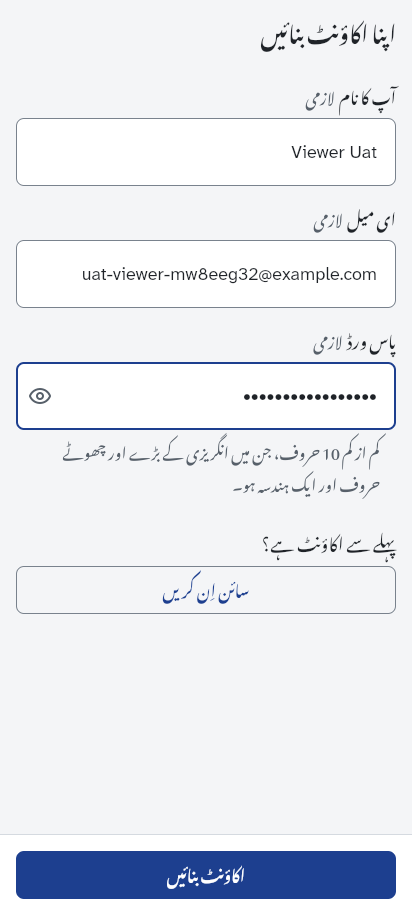

### J8 Role limits: a viewer cannot record payments

Steps (viewer, Urdu): Open portfolio; Money; the tenant's ledger. Then the same `record_payment`
call the app makes, sent with the viewer's own session.

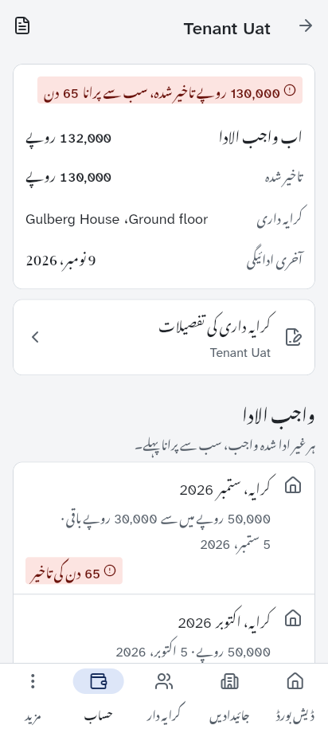

| Expected                                                            | Actual                                                       |
| ------------------------------------------------------------------- | ------------------------------------------------------------ |
| The viewer sees the owner's figures                                 | "واجب الادا 132000 روپے"                                     |
| No record payment, add charge, use deposit or refund deposit action | None of the four buttons exists                              |
| The database refuses the payment even when asked directly           | HTTP 403 `{"code":"42501","message":"forbidden"}`; 1 payment |

### J9 Dashboard figures match the ledger

Steps: Dashboard. The suite computes owed, overdue, the ageing buckets and this month's dues and
payments from `public.charges` and compares each with the screen.

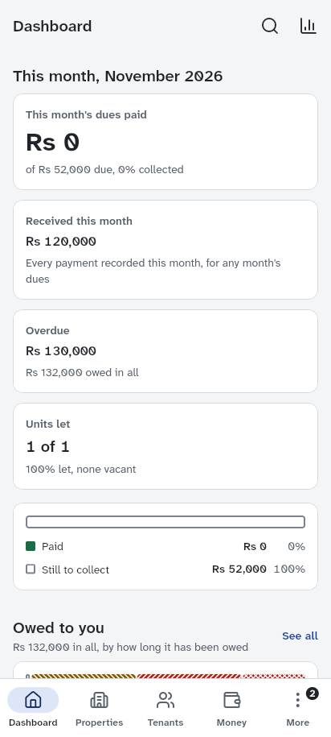

| Expected                                                      | Actual                                                                    |
| ------------------------------------------------------------- | ------------------------------------------------------------------------- |
| Overdue, owed in all and every ageing bucket equal the ledger | Rs 130,000 overdue; Rs 132,000 owed; 2,000 / 50,000 / 50,000 / 30,000 / 0 |
| Units let, deposits held                                      | "1 of 1"; Rs 100,000                                                      |
| What was collected this month                                 | "Collected this month Rs 0" although Rs 120,000 came in today (**D2**)    |

### J10 Upload a document to private storage, then delete it

Steps (owner): the tenant; Add document; Choose a file (a synthetic PNG); Upload; open it;
Download; Delete; confirm. Then the `storage-cleanup` function, as pg_cron calls it.

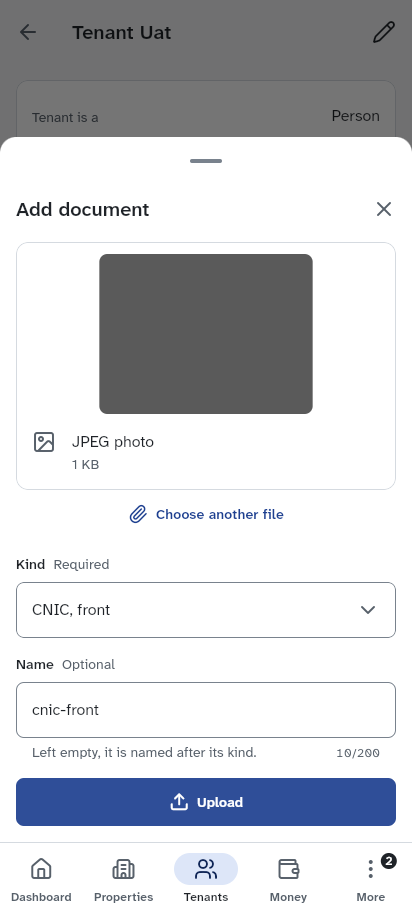

| Expected                                                              | Actual                                                                                  |
| --------------------------------------------------------------------- | --------------------------------------------------------------------------------------- |
| The photo is re-encoded as JPEG on the device (metadata dropped)      | "JPEG photo"; row and object `image/jpeg`, kind `cnic_front`                            |
| The bucket is private                                                 | The public URL of the object is refused                                                 |
| Download works through a signed link                                  | `cnic-front.jpg`, starting `FF D8 FF`                                                   |
| Delete removes the row at once and the file through the cleanup queue | Row gone; queued in `private.storage_cleanup_queue`; object gone after the function ran |

### J11 End the tenancy

Steps: the tenancy; End tenancy; moved out today, "The tenant moved out"; End tenancy; the unit.

| Expected                                   | Actual                                                     |
| ------------------------------------------ | ---------------------------------------------------------- |
| The tenancy is ended today with its reason | "Tenancy ended."; `status` ended, `moved_out_on` today     |
| The unit is vacant again                   | "Vacant since …" on the unit                               |
| The deposit settlement is offered          | The ledger offers to use the deposit, then refund the rest |

### J12 The owner switches to Urdu

Steps: More (still on Team from J7: **D4**); Settings; Language اردو; Dashboard; Money; the
receipt; Share receipt in Urdu.

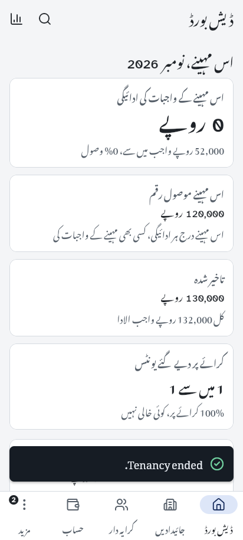

| Expected                                                       | Actual                                                          |
| -------------------------------------------------------------- | --------------------------------------------------------------- |
| The UI switches to Urdu and the choice is saved to the profile | Urdu everywhere; `profiles.locale` = `ur`; `<html lang="ur">`   |
| The dashboard and the ledger show the same figures in Urdu     | "کل 132,000 روپے واجب الادا"                                    |
| An Urdu PDF receipt on one A5 page, like the English one       | A valid PDF, but of 2 pages: the second holds one line (**D8**) |

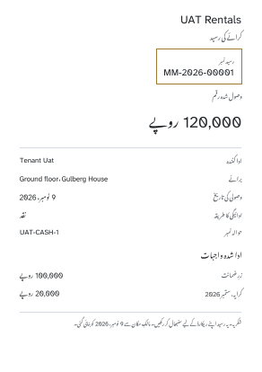

### J13 Settle the deposit after the tenancy ends (Urdu)

Steps: Open the ledger; Use for dues; Rs 100,000; confirm.

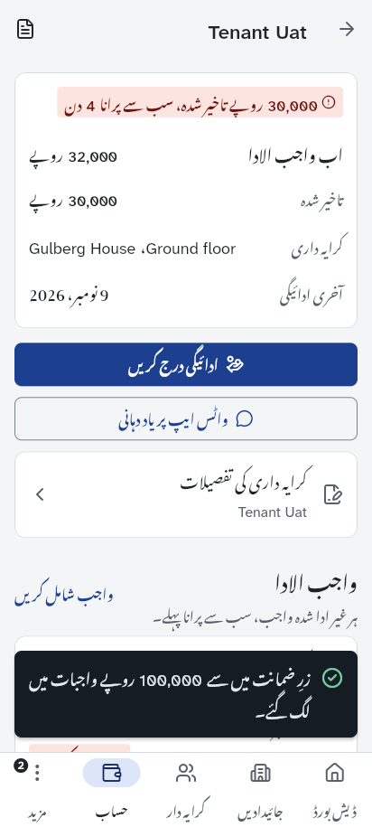

| Expected                                                        | Actual                                            |
| --------------------------------------------------------------- | ------------------------------------------------- |
| The deposit pays the oldest dues and a second receipt is issued | "100,000 روپے رسید MM-2026-00002"; deposit held 0 |
| What is still owed equals the database                          | Rs 32,000 on screen and in `sum(outstanding)`     |

### J14 Account deletion: the viewer, then the owner (Urdu)

Steps: Settings; Delete account; password and e-mail; Delete my account. First the viewer, then
the owner.

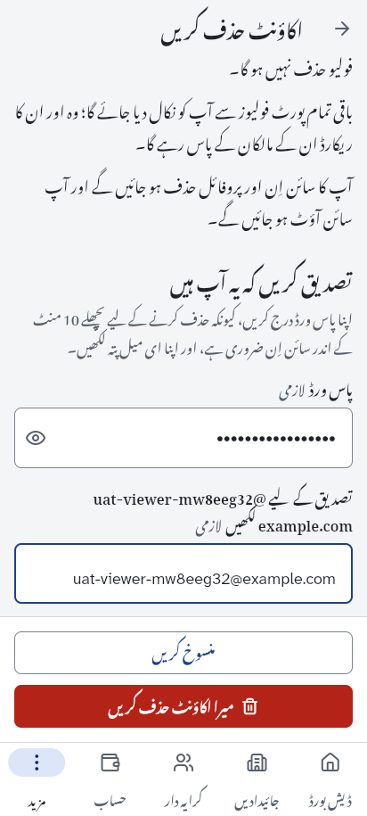

| Expected                                                 | Actual                                                                                          |
| -------------------------------------------------------- | ----------------------------------------------------------------------------------------------- |
| The viewer is told no portfolio goes with their account  | As expected                                                                                     |
| The viewer's user and membership go; the portfolio stays | `auth.users` row gone; the portfolio keeps 1 member                                             |
| The sole owner's portfolio goes with their account       | User gone; no row left in portfolios, leases, tenants, properties, payments, charges, documents |
| Both are signed out with a confirmation                  | Sign-in screen with "Your account has been deleted" (in Urdu)                                   |

## Defects

Severity: Critical blocks a release or a deploy; High breaks a main journey; Medium misleads a
user or excludes assistive-technology users from a task; Low is cosmetic or confusing. The UAT
stage recorded them; the release-readiness stage fixed them
([`release-readiness.md`](release-readiness.md) has the evidence).

| #   | Severity | Defect                                                                           | Status: fixed by                                                                                           |
| --- | -------- | -------------------------------------------------------------------------------- | ---------------------------------------------------------------------------------------------------------- |
| D1  | Critical | Migration `20261108200216_identity_checks` cannot be applied by the Supabase CLI | `begin; … commit;` around the file; `tool/db/check_migration_transactions.py` in `make lint`               |
| D2  | Medium   | "Collected this month" counts only this month's dues paid, not money received    | "This month's dues paid" and a new "Received this month" figure (`cash_received`); J9 asserts both         |
| D3  | Medium   | The invitation link is invisible to screen readers                               | A labelled semantics node carrying the link; J7 finds it by its accessible name                            |
| D4  | Low      | The Team screen kept in the More tab stays stale after an invitation is accepted | `RefreshWhenShown` reloads the team when the screen is shown again; J12 asserts it                         |
| D5  | Low      | "Vacant since" uses the UTC date of the unit's creation                          | Migration `20261109081109_uat_display_fixes` (Asia/Karachi date); pgTAP suite 21; J2 asserts today's date  |
| D6  | Low      | Automatic late fees carry an English note, shown in the Urdu UI                  | The same migration: no note on automatic fees, and the old ones cleared; J6 asserts it                     |
| D7  | Low      | The stepper fields expose no value text on the web                               | On the web the stepper's name carries its value ("Grace days, 5 days"); J4 asserts it                      |
| D8  | Low      | The Urdu receipt PDF takes a second page for its footer line                     | Tighter receipt layout; a test that a usual receipt is one A5 page in both languages; J12 asserts one page |

### D1 Critical: a migration the Supabase CLI cannot apply

- **Where:** `supabase/migrations/20261108200216_identity_checks.sql`, line 163
  (`lock table public.tenants, … in share row exclusive mode`).
- **What happens:** `supabase start` stops with
  `ERROR: LOCK TABLE can only be used in transaction blocks (SQLSTATE 25P01) At statement: 8`, and
  the stack shuts down. The CLI sends a migration's statements outside a transaction block;
  `tool/db/reset.sh` passes `--single-transaction`, which is why the local pgTAP runs pass.
  `supabase db reset` applies migrations the same way, and the Deploy workflow's
  `supabase db push --linked` very likely does too (not run here: it targets the hosted project).
- **Consequences:** CI's `supabase-stack` job and the new `uat` job cannot start the stack at this
  commit, and any `db push` to a project that has not applied the file stops at it. (The hosted
  project records the version, so its next deploy skips it.)
- **Correction (release-readiness stage):** this report first said that the `set local
lock_timeout` / `statement_timeout` lines of five migrations also do nothing under the CLI. They
  do work: the CLI sends a file as one pipelined batch, one implicit transaction, in which
  `SET LOCAL` holds until the batch ends (a probe migration `set local lock_timeout = '5s'; create
table … as select current_setting('lock_timeout')` stored `5s`), and a later failing statement
  rolls the whole file back. Only statements that need a transaction _block_, such as `LOCK
TABLE`, fail. The earlier check ran `SET LOCAL` in psql's autocommit mode, which is not what the
  CLI does.
- **Reproduce:** `supabase start` on a clean Docker volume.
- **Suggested direction:** wrap the migration's body in `begin; … commit;`, or take the lock in a
  `do` block, and check with `supabase db reset` in CI before merging migrations.

### D2 Medium: "Collected this month" is not money collected this month

- **Where:** `app/lib/src/features/insights/presentation/dashboard_screen.dart`, lines 170–171
  (`collectedThisMonthLabel` shows `month.paid`); `get_dashboard`'s `month_dues` in
  `supabase/migrations/20261107172908_police_registration_rules.sql`.
- **What happens:** on the day Rs 120,000 cash was received, the dashboard says "Collected this
  month Rs 0 of Rs 52,000 due, 0% collected", because the payment settled older dues (the deposit
  and September's rent). `get_dashboard` also returns `cash_received`, the sum of the month's
  payments, which the app reads (`MonthCollection.cashReceived`) and uses only inside an insight
  rule (`insight_rules.dart`, line 384); no screen shows it.
- **Suggested direction:** label the figure as this month's dues paid, and show the money received
  this month next to it.

### D3 Medium: the invitation link is not exposed to assistive technology

- **Where:** `app/lib/src/features/team/presentation/invite_member_screen.dart`, lines 222–231
  (`SelectableText(link.url.toString())`).
- **What happens:** on the web the link becomes a disabled, unlabelled text field whose value is
  empty in the accessibility tree (`textbox [disabled]`), so a screen-reader user cannot hear or
  check the link; only "Copy link" reaches it. The suite reads the link from the clipboard for this
  reason.
- **Suggested direction:** give the link a semantics label (or plain `Text` with `Semantics`), and
  keep Copy link.

### D4 Low: stale Team screen when coming back through the More tab

- **Where:** the shell's stateful More branch with `features/team/presentation/team_screen.dart`.
- **What happens:** after the viewer accepted the invitation, the owner's More tab came back on
  the Team screen still listing it under "Invitations waiting for an answer", with the viewer
  missing from People. Leaving and opening Team again shows the right list.
- **Suggested direction:** refresh the team query when the screen becomes visible again.

### D5 Low: "Vacant since" is the UTC date

- **Where:** `public.unit_occupancy` (`supabase/migrations/20261103194625_reports.sql`, line 64)
  and `get_dashboard` (line 206 there; line 402 of `20261107172908_police_registration_rules.sql`):
  `u.created_at::date`.
- **What happens:** the database runs in UTC, so a unit added at 01:30 on 9 Nov in Pakistan reads
  "Vacant since 8 Nov 2026" and counts a day of vacancy too many. The rest of the schema uses
  `app.today_pkt()`.
- **Suggested direction:** `(u.created_at at time zone 'Asia/Karachi')::date`.

### D6 Low: automatic late fees carry an English note

- **Where:** `private.assess_late_fees` writes `description = 'Late fee'`
  (`supabase/migrations/20261104143928_ledger_jobs_hardening.sql`, line 707); the ledger prints
  the note (`app/lib/src/features/ledger/presentation/tenancy_ledger_screen.dart`, line 319).
- **What happens:** every automatic fee reads "Late fee, September 2026 … · Late fee" in English
  (the kind twice) and "تاخیر جرمانہ، ستمبر 2026 … · Late fee" in Urdu.
- **Suggested direction:** leave the note empty for automatic fees (the kind already says it), or
  translate known system notes in the app.

### D7 Low: stepper fields expose no value text on the web

- **Where:** `packages/mm_ui/lib/src/components/choices/mm_stepper_field.dart`, lines 170–178,
  used for grace days and the increase interval on the tenancy form.
- **What happens:** the widget gives a label and a value ("5"), but Flutter's web engine renders
  an `<input type="range">` with no `aria-valuetext`, `aria-valuenow` or label of its own (its
  parent carries "Grace days"); the accessibility tree reads it as a slider of value "1" or "50".
  Likely an engine limitation; worth checking with TalkBack and VoiceOver on the web.

### D8 Low: the Urdu receipt spills onto a second page

- **Where:** `app/lib/src/features/ledger/presentation/pdf/ledger_pdfs.dart` (the receipt layout).
- **What happens:** the same receipt is one A5 page in English and two in Urdu; page 2 holds only
  "Made with Maalik-e-Makaan on 9 November 2026" (see J12). Taller Nastaliq lines push the footer
  over.

## Environment

The stack ran in the agent container with these adjustments, none of which changes the app or the
schema under test, and none of which CI needs:

- **Supabase CLI 2.122.1** installed from the official release tarball
  (`supabase_2.122.1_linux_amd64.tar.gz`), its SHA-256 checked against the release's
  `checksums.txt`.
- **Images from Docker Hub.** The default registry (`public.ecr.aws`) was refused by the network
  policy, so `SUPABASE_INTERNAL_IMAGE_REGISTRY=docker.io` was set; the image versions are the CLI's
  own (Postgres 17.11.0.006, GoTrue 2.197.0, PostgREST 16.5, Storage 1.84.19, Edge Runtime 1.77.8,
  Mailpit 1.31.3, Kong 2.8.1).
- **Docker's data on a RAM disk** (the shared disk had about 1 GB free).
- **D1** was bypassed by applying the migrations from a scratch copy of `supabase/` in which
  `20261108200216_identity_checks.sql` alone is wrapped in `begin; … commit;`, the transaction its
  own comments assume. The repository's file is unchanged.
- **The edge-runtime container** was recreated with the network proxy's CA certificate, because
  the container's network re-signs TLS and the runtime could not download its npm dependencies.

Two behaviours of Flutter's web semantics shaped the helpers in `app/uat/support/app.ts`: the
semantics DOM must be switched on (the hidden "enable accessibility" button), and scrolling it
(`scrollIntoView`, the mouse wheel) moves the DOM without moving Flutter's view, so a pointer click
after it lands on whatever is painted there. The suite therefore activates controls with a click
event on their semantics node, as a screen reader does, and types after focusing the field without
scrolling. Only the file chooser gets a real pointer click, because browsers open it only on a user
gesture.
